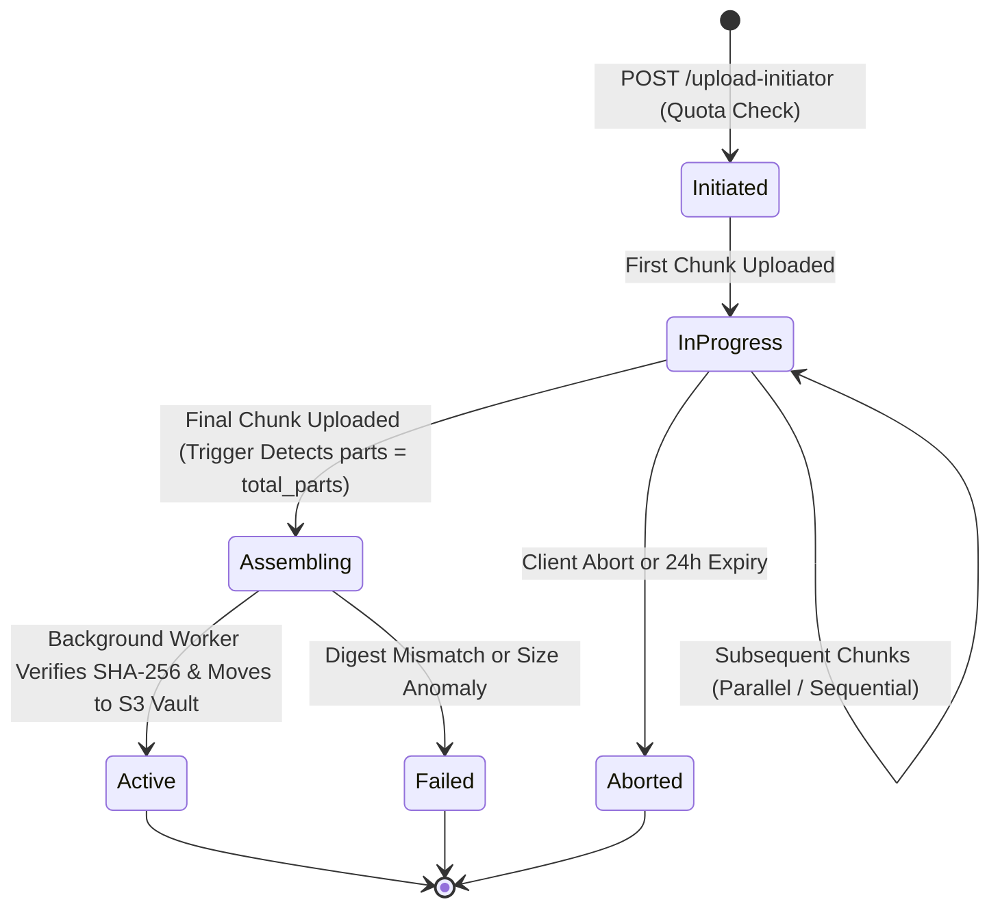

# 📦 Storage Engine & Distributed Chunking Pipeline Deep Dive

**Technical Specification & Protocol Blueprint**  
**Role Scope:** Senior / Staff Storage Engineer Reference  
**Author:** Philippe Godfroy  

---

## 1. Challenge & Problem Statement

High-throughput asset ingestion (genomic data lakes, medical imaging, video datasets) poses critical challenges:
- **Flaky Mobile & Edge Connections**: A single network blip at 98% of a 2GB file upload aborts the entire transfer if using naive single-PUT HTTP uploads.
- **Connection Saturation & Memory Spikes**: Buffering full gigabyte streams on edge function instances causes memory exhaustion (OOM).
- **Silent Bit Rot & Tampering**: Missing end-to-end cryptographic checksums risk corrupted or incomplete assemblies in S3.
- **Tenant Quota Exhaustion Race Conditions**: Parallel uploads from the same organization could bypass quota limits if byte checks are decoupled from database transactions.

---

## 2. The Resumable Multipart Architecture

This architecture combines the **AWS S3 Multipart Protocol** with **TUS Resumability Principles**:



### 2.1 Chunk Slicing & Checksum Mechanics

Files are sliced into deterministic **5 MiB chunks** (the S3 standard minimum):

$$\text{Total Parts} = \left\lceil \frac{\text{File Size Bytes}}{5 \times 1024 \times 1024} \right\rceil$$

For each part $k$:
1. **MD5 ETag Calculation**:  
   $$\text{ETag}_k = \text{MD5}(\text{ChunkBuffer}_k)$$
2. **Cryptographic SHA-256 Digest**:  
   $$\text{SHA256}_k = \text{SHA256}(\text{ChunkBuffer}_k)$$
3. **Multipart S3 Root ETag**:  
   $$\text{RootETag} = \text{MD5}(\text{RawHex}(\text{ETag}_1) \mathbin{\Vert} \dots \mathbin{\Vert} \text{RawHex}(\text{ETag}_n)) \mathbin{\Vert} \text{"-"} \mathbin{\Vert} n$$

---

## 3. Atomic Quota Enforcement & Zero Race Conditions

Naive architectures calculate `used_bytes` asynchronously. Under 50 concurrent uploads, an organization with 1GB remaining could initiate fifty 500MB uploads simultaneously, causing a 24GB overage!

### The Solution: Shared Row Lock Guard
In `20261027000004_storage_engine_triggers.sql`, the initiation trigger executes:

```sql
SELECT storage_used_bytes, max_storage_bytes, is_active
INTO v_used_bytes, v_max_bytes, v_is_active
FROM public.organizations
WHERE id = NEW.org_id
FOR SHARE; -- Lightweight shared lock

IF (v_used_bytes + NEW.expected_size_bytes) > v_max_bytes THEN
    RAISE EXCEPTION 'Storage quota exceeded' USING ERRCODE = '54000';
END IF;
```

`FOR SHARE` serializes conflicting reservation checks without blocking concurrent read queries on the organization.

---

## 4. Resumption State Machine & Flaky Network Recovery

When a network connection drops:
1. The client SDK queries `public.object_parts WHERE upload_id = :id`.
2. The database returns an array of already committed part numbers: `[1, 2, 4]`.
3. The client slices the source buffer, skips parts 1, 2, and 4, and resumes uploading part 3 and parts 5 through $N$.
4. **Zero wasted bandwidth**: Only dropped chunks are retransmitted.

---

## 5. Edge CDN & Caching Invalidation

Public asset delivery leverages a multi-tiered CDN strategy:
- **Immutable URL Pattern**: `/storage/v1/object/public/vaults/:vault_slug/:object_key?v=:version_id`
- **Headers**:
  ```http
  Cache-Control: public, max-age=31536000, immutable
  ETag: "ca978112ca1bbdcafac231b39a23dc4da786081441606713e439227274291100"
  Content-Disposition: inline; filename="document.pdf"
  ```
- **Instant Invalidation**: Mutations increment `version_id` in `vault_objects`, generating a fresh CDN cache key while maintaining zero downtime.
