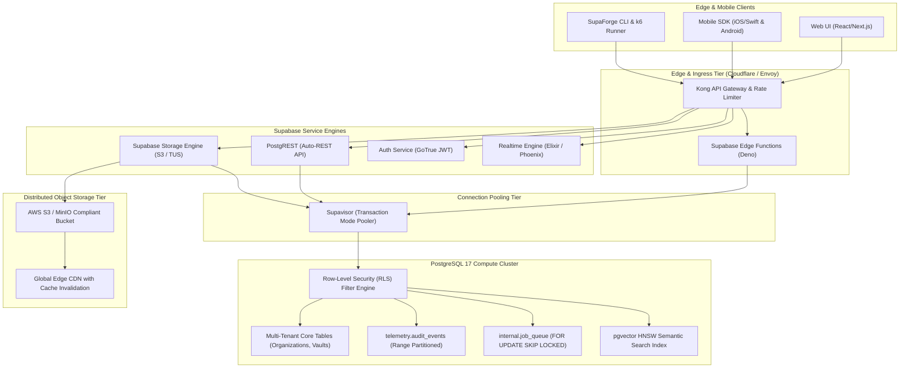
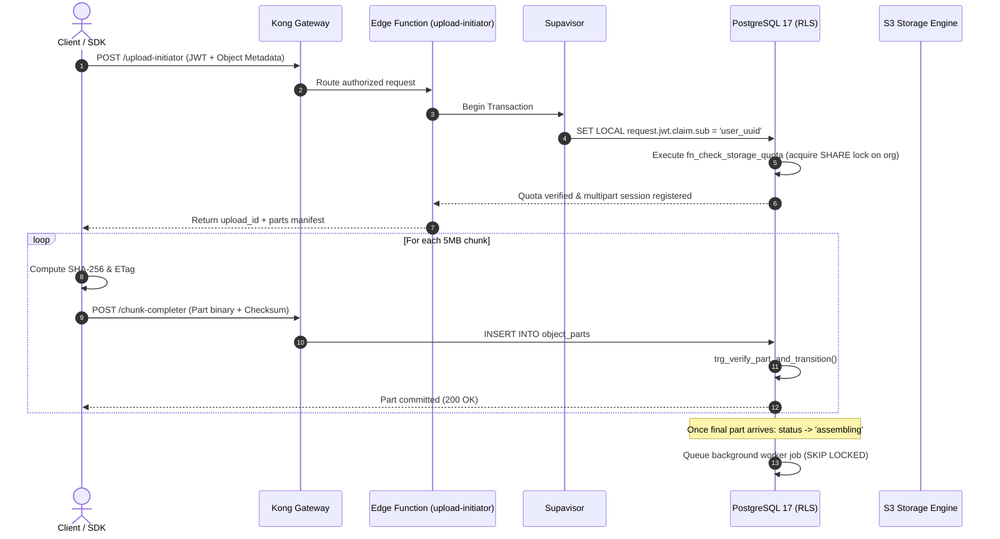

# 🏛️ System Architecture Specification

**Production-Grade Supabase Enterprise Architecture**  
**Classification:** Staff-Level Reference Implementation  
**Author:** Philippe Godfroy  

---

## 1. High-Level Topology & Microservices Decomposition

The architecture isolates concerns across client entrypoints, stateless serverless edge runtimes, connection multiplexers, and PostgreSQL 17 compute nodes backed by S3-compatible distributed object storage.

---

## 2. Decoupled Storage-Compute Architecture

Modern enterprise architectures decouple compute and storage to achieve independent scaling, high durability, and cost efficiency:

1. **Metadata & State Machine (PostgreSQL Compute)**:
   All tenant boundaries, file manifests, multipart part descriptors, SHA-256 digests, and quota accounting reside in PostgreSQL.
2. **Binary Payloads (Distributed Object Storage / S3)**:
   Raw binary blobs bypass database transaction logs (WAL) completely. Blobs are chunked at the client, streamed via presigned URLs or Supabase Storage, and stored in S3-compatible buckets.
3. **Connection Multiplexing via Supavisor**:
   Serverless edge environments (Deno Edge Functions) initiate hundreds of concurrent short-lived connections. Direct connection to PostgreSQL would exhaust backend process limits (`max_connections`). Supavisor operates in **transaction mode**, recycling server connections immediately after each transaction commits.

---

## 3. Request Lifecycle & Authentication Flow

---

## 4. Architectural Invariants

- **Zero-Trust Multi-Tenancy**: Every database table with tenant association MUST have `ROW LEVEL SECURITY` enabled and forced (`FORCE ROW LEVEL SECURITY`).
- **No Volatile Functions in RLS Predicates**: Functions that query authentication state must be wrapped in scalar subqueries `(SELECT auth.uid())` to allow PostgreSQL to generate an **InitPlan** rather than executing row-by-row function calls.
- **Strict Byte-Accounting Consistency**: Storage quota calculations use database triggers with atomic updates, eliminating race conditions in parallel uploads.
