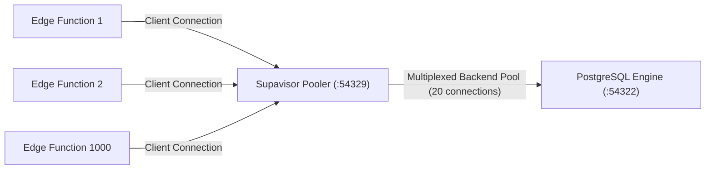

# ⚡ PostgreSQL & Supabase Engine Performance Tuning Playbook

**Senior DBA & SRE Architecture Guide**  
**PostgreSQL Version:** 17.x | **Connection Pooler:** Supavisor  
**Author:** Philippe Godfroy  

---

## 1. Memory Budgeting & Kernel Parameter Calculation

For a dedicated compute instance (e.g. 16 vCPU, 64 GB RAM):

| Parameter | Recommended Setting | Architectural Justification |
| :--- | :--- | :--- |
| `shared_buffers` | `16GB` (25% of RAM) | Primary cache for hot table pages and index blocks. Prevents kernel context switching. |
| `effective_cache_size` | `48GB` (75% of RAM) | Informs PostgreSQL query planner of OS filesystem page cache availability. |
| `work_mem` | `32MB` | Dedicated memory per sort/hash operation. Budgeted for: $\text{work\_mem} \times \text{max\_connections} \le \text{Total RAM} \times 0.25$. |
| `maintenance_work_mem` | `2GB` | Accelerates `VACUUM`, `CREATE INDEX`, and partition maintenance. |
| `wal_buffers` | `64MB` | Buffers transaction log writes before disk sync. Prevents I/O stalls on high write bursts. |
| `random_page_cost` | `1.1` | Calibrated for NVMe SSD / EBS gp3 storage (down from spinning disk default `4.0`). |

---

## 2. Supavisor Connection Pooler Architecture

Connection pooling is essential when deploying serverless edge functions.



### 2.1 Mode Comparison: Transaction vs Session

- **Transaction Mode (Recommended)**:
  A backend connection is assigned to a client ONLY for the duration of a transaction block (`BEGIN ... COMMIT`). Once committed, the connection returns to the pool immediately.
  *Caveat:* Session-level state (e.g. `LISTEN/NOTIFY`, `SET search_path`, named prepared statements) must be handled through transaction-local commands (`SET LOCAL`).
- **Session Mode**:
  Client holds the server connection for its entire network lifetime. Recommended only for heavy batch jobs or persistent stateful backends.

---

## 3. Production Indexing Taxonomy

Every index in this repository was selected to eliminate sequential table scans:

### 3.1 Composite Covering Indexes (`INCLUDE`)
```sql
CREATE INDEX idx_vault_objects_tenant_vault_active
    ON public.vault_objects (org_id, vault_id, created_at DESC)
    INCLUDE (object_key, size_bytes, content_type, status)
    WHERE deleted_at IS NULL;
```
**Impact:** Satisfies tenant vault listing queries entirely in RAM via **Index-Only Scan**. The engine never touches heap disk pages (`Heap Fetches: 0`).

### 3.2 GIN with `jsonb_path_ops` for Metadata Tags
```sql
CREATE INDEX idx_vault_objects_metadata_gin
    ON public.vault_objects USING gin (metadata jsonb_path_ops);
```
**Impact:** `jsonb_path_ops` hashes each JSON path and value into a single 32-bit hash, producing index sizes **60% smaller** than default `jsonb_ops` while delivering sub-millisecond `@>` containment lookups.

### 3.3 BRIN (Block Range Index) on Partitioned Audit Logs
```sql
CREATE INDEX idx_audit_events_created_at_brin
    ON telemetry.audit_events USING brin (created_at);
```
**Impact:** Because time-series events are naturally append-only and physically ordered on disk, BRIN summarizes ranges of disk blocks rather than indexing every single row. Result: Index occupies **less than 1%** of the space of a traditional B-Tree index.

---

## 4. Autovacuum Tuning for High-Throughput Storage

High-volume metadata tables (such as `object_parts` and `vault_objects`) generate dead tuples during updates and deletes. Default autovacuum triggers too late, leading to table bloat and degraded cache efficiency.

```sql
-- Aggressive autovacuum for high-churn storage metadata
ALTER TABLE public.vault_objects SET (
    autovacuum_vacuum_scale_factor = 0.05,  -- Trigger vacuum after 5% tuple churn
    autovacuum_vacuum_threshold = 1000,
    autovacuum_vacuum_cost_limit = 2000     -- Increase worker I/O budget
);
```
